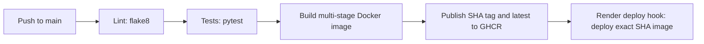

# CodeNova CI/CD Pipeline

A small FastAPI web service with automated linting, tests, a multi-stage Docker
build, immutable image publishing to GitHub Container Registry (GHCR), and
deployment to a Render image-backed web service.

## Architecture



The workflow runs only for pushes to `main`. The `test` job waits for `lint`,
`build` waits for `test`, and `deploy` requires both `test` and `build`.
Render receives the image tagged with the commit SHA, so a deployment does not
depend on the mutable `latest` tag.

## Project layout

```text
.
├── .github/workflows/deploy.yml
├── app/main.py
├── tests/test_main.py
├── Dockerfile
├── requirements.txt
└── requirements-dev.txt
```

## Run locally

Requires Python 3.12 or Docker.

```bash
python -m venv venv
# Windows PowerShell:
venv\Scripts\Activate
# macOS/Linux:
# source .venv/bin/activate
python -m pip install -r requirements-dev.txt
python -m flake8 app tests
python -m pytest -q
python -m uvicorn app.main:app --reload
```

The webpage is available at `http://localhost:8000/`. The JSON API response is
at `http://localhost:8000/api`; health checks use
`http://localhost:8000/healthz`. Interactive API documentation is at
`http://localhost:8000/docs`.

Build and run the same container locally:

```bash
docker build -t codenova-service:local .
docker run --rm -p 8000:8000 codenova-service:local
```

## GitHub and registry setup

1. Push this project to a GitHub repository and ensure its default branch is
   named `main`. Enable GitHub Actions for the repository.
2. The workflow uses the automatically provided `GITHUB_TOKEN` to publish to
   `ghcr.io`; grant the workflow the `packages: write` permission (already
   scoped to the `build` job). No Docker Hub username or password is required.
3. After the first successful build, open the repository's **Packages** page
   and confirm the image is named `ghcr.io/<owner>/<repository>`. Keep it
   private unless you specifically want public image access.
4. Create a GitHub personal access token (classic) with **read:packages** for
   Render to pull a private GHCR image. Add it in Render under registry
   credentials; use the GitHub account name as the username. This token is
   stored by Render, not in this repository or workflow.

## Render deployment setup

1. After the first workflow run publishes an image, create a Render **Web
   Service** using **Existing Image** and
   `ghcr.io/<owner>/<repository>:<first-commit-sha>`. Select the GHCR credential
   from the previous section. Choose the free instance plan if available in
   your Render account and region.
2. Configure the service's health check path as `/healthz`. The container
   listens on Render's `PORT` environment variable (default `8000`).
3. In the Render service's **Settings**, create a deploy hook and copy its URL.
4. In GitHub, open **Settings → Secrets and variables → Actions → New repository
   secret**. Add:

   | Secret | Value |
   | --- | --- |
   | `RENDER_DEPLOY_HOOK_URL` | The Render deploy-hook URL |

5. Re-run the first workflow after adding the secret, or push a new commit to
   `main`. Each successful build publishes both a commit-SHA tag and `latest`;
   the deploy job asks Render to deploy the commit-SHA tag.

The first workflow run is also the image bootstrap: if the Render hook has not
yet been configured, the image is still published but the `deploy` job fails
with a clear missing-secret error. Create the Render service from that image,
add the secret, and rerun the failed workflow.

## Secrets and log safety

- The only GitHub repository secret used by this workflow is
  `RENDER_DEPLOY_HOOK_URL`. The GHCR login uses the short-lived,
  repository-scoped `GITHUB_TOKEN`, not a stored registry password.
- Never commit hook URLs, access tokens, `.env` files, or credentials. Rotate
  the Render hook in its dashboard if it is exposed.
- The deploy step passes the hook URL through an environment variable and
  `curl` without verbose mode; response bodies and command output are discarded.
  It does not print the URL, token, or image credentials. Do not enable shell
  tracing (`set -x`) or print environment variables in workflow steps.
- GitHub masks configured secrets in logs, but masking is a fallback rather
  than a reason to print them. The GHCR pull token belongs in Render's
  credential store and is never passed to GitHub Actions.

## Failure alerts and validation

The `failure-notice` job adds a link to the failed run in the workflow summary.
GitHub also marks the run as failed. To receive email or mobile alerts, enable
**GitHub → Settings → Notifications → Actions** notifications (and select the
repository or watch-all-repositories option that matches your preference).
Open the failed run and inspect the first failed job; later dependent jobs are
expected to be skipped.

Before deploying, validate locally:

```bash
python -m flake8 app tests
python -m pytest -q
docker build -t codenova-service:local .
docker run --rm -d --name codenova-check -p 8000:8000 codenova-service:local
curl --fail http://localhost:8000/healthz
docker stop codenova-check
```

In GitHub, verify that a push to `main` runs all four jobs in order, publishes
the image tags, and triggers the Render deployment. A push to another branch
does not start this workflow.

## Rollback and recovery

**Render rollout fails:** Open the service's **Events** page, select the last
healthy deployment, and use Render's rollback/redeploy action. Check its logs
and health check before sending traffic back to the new version.

**Redeploy a known-good image:** Use the immutable commit SHA shown in the
successful workflow run or Render deployment history. In Render, update the
image URL to `ghcr.io/<owner>/<repository>:<known-good-sha>` and deploy. The
GHCR package must remain available, and Render must retain valid read access.

**Revert a bad code change:** Find the offending commit and revert it rather
than rewriting shared branch history:

```bash
git log --oneline
git revert <bad-commit-sha>
git push origin main
```

The revert runs through lint, tests, image build, and deployment like any other
push. If the deployment hook itself fails, inspect the Render service status
and hook configuration, rotate the hook if necessary, update the GitHub
repository secret, then rerun the failed workflow.
